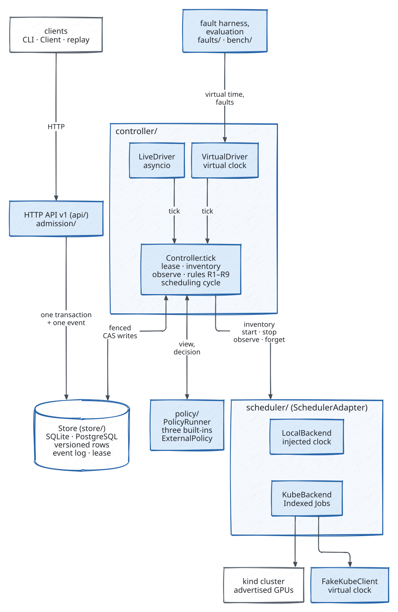
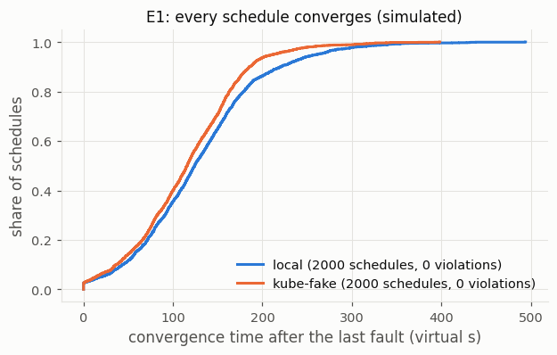
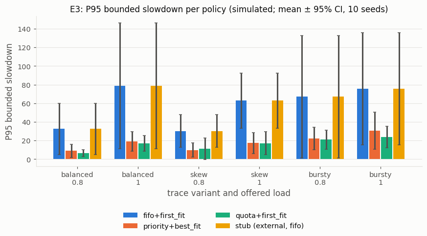

<p align="center"></p>

<p align="center">
<a href="https://github.com/AKASB1/ai-workload-platform/actions/workflows/ci.yml"></a>
<a href="LICENSE"></a>


</p>

# AI Workload Platform

`ai-workload-platform` is a control plane for AI workloads on shared GPU compute that keeps its state correct when its parts fail.

<p align="center"><a href="#documentation">Documentation</a> · <a href="#highlights">Highlights</a> · <a href="#usage">Usage</a> · <a href="#how-it-works">How it works</a> · <a href="#results">Results</a> · <a href="#limitations">Limitations</a></p>

> **Simulated GPUs.** Every result here comes from workloads that sleep for their run time, with assumed cluster and workload parameters ([protocol](benchmarks/README.md#protocol-fixed-before-the-first-evaluation-run)).

How does a control plane keep its records true when its controller crashes, its store fails, or a node disappears? This project answers with a versioned store, a reconciler, and a fault-injection harness. The store and its append-only event log are the only source of truth: SQLite by default, PostgreSQL through the same code. The reconciler repairs what a crash or a lost node leaves behind, except a node that never comes back. The harness checks the invariants after every step. A pluggable policy decides which workload starts where. Two backends run the decisions: a deterministic local one, and Kubernetes Indexed Jobs on kind (Kubernetes in Docker) or on a fake client (the Kubernetes fake).

<p align="center"></p>

## Documentation

- Design: [docs/architecture.md](docs/architecture.md) (modules, the control loop, reconciliation) and [docs/contracts.md](docs/contracts.md) (specification, lifecycle, store, API, backends, rules)
- Evaluation: [docs/failure-injection.md](docs/failure-injection.md) (schedules, crash points, invariants, injected bugs) and [benchmarks/README.md](benchmarks/README.md) (protocol, full results, limitations)
- Running it: [deploy/README.md](deploy/README.md) (Docker Compose, the kind cluster, manifests) and [docs/kubernetes.md](docs/kubernetes.md) (the Kubernetes backend and its measurements)
- API: [docs/openapi.json](docs/openapi.json)
- Implementation plan: [IMPLEMENTATION.md](IMPLEMENTATION.md); contributing: [CONTRIBUTING.md](CONTRIBUTING.md)

## Safety

The API has no authentication. `up` binds it to `127.0.0.1` by default. The container image, the compose file, and the Kubernetes Deployment bind it to `0.0.0.0` inside their networks, so anything on those networks can use the API. Keep them off untrusted networks.

## Highlights

The evaluation has three parts: E1 injects faults, E2 runs one trace on three backends, and E3 compares policies. Except on kind, everything runs on a virtual clock that jumps from one event to the next. The baseline policy is `fifo+first_fit`: it starts workloads in submit order and blocks the queue when the head does not fit. Policies are compared on P95 bounded slowdown ([definition](docs/contracts.md#9-evaluation-metrics)). A workload's bounded slowdown is its time from submission to completion over its ideal run time (at least 10 s), and at least 1.

- **Fault injection finds no invariant violation.** E1 runs 2000 seeded fault schedules per backend and finds 0 violations. On the local backend it injects 6 539 faults of 16 kinds and hits all 7 crash points, the named places where it crashes the controller. On the Kubernetes fake it injects 6 480 faults of 14 kinds ([table](benchmarks/README.md#e1-failure-injection)).
- **The harness catches every injected bug.** Each of the four test-only bugs is caught on both backends; bug 2 (`no_epoch_check`) only in 3 of 200 local and 1 of 200 fake schedules ([table](benchmarks/README.md#e1-failure-injection)).
- **The fake agrees with the local backend on makespan and wait; kind adds end-detection lag.** On the same trace (seeds 1–10), the local backend and the Kubernetes fake reach a makespan of 12 622 and 12 624 trace seconds. Their mean waits are 763 and 764. On kind the platform records the end of a pod seconds after it happened ([table](benchmarks/README.md#e2-backends)).
- **The skipping policies cut the tail slowdown.** `priority+best_fit` and `quota+first_fit` beat the baseline on P95 bounded slowdown on 9 or 10 of 10 seeds. That holds in all six settings of trace variant and load ([table](benchmarks/README.md#e3-policies)).
- **An external policy reproduces its own simulator.** The policy server of `gpu-cluster-scheduler` runs through the external-policy protocol. It gives the same start times, end times, and placements as that project's simulator: 0 differences on 3 × 200 workloads ([details](docs/contracts.md#11-conformance-with-gpu-cluster-scheduler)).
- **Preemption trades slowdown for SLO attainment.** With checkpoints, `priority+best_fit+preempt` raises SLO attainment over `priority+best_fit` in every setting (0.928 → 0.990 at `balanced` 1.0). SLO attainment is the share of succeeded workloads with a wait target that start within it. The preempting policy loses to its base on P95 bounded slowdown on 6–8 of 10 seeds ([table](benchmarks/README.md#extensions)).

## Usage

You need Python 3.12 (`pyproject.toml`). The install uses `pip install -e`, and the build backend `hatchling` comes from PyPI or your mirror. After the install, the tests, the quick benchmark, and the demo need no Docker, GPU, or network access. Run the commands from the repository root.

Install the package, run the tests and the quick benchmark, then the demo. In Windows PowerShell:

```powershell
python -m venv .venv
.venv\Scripts\python.exe -m pip install -e ".[dev]"
.venv\Scripts\python.exe -m pytest -q
.venv\Scripts\python.exe -m ai_workload_platform bench --quick
.venv\Scripts\python.exe scripts\demo.py
```

On Linux or macOS (bash):

```bash
python3 -m venv .venv
.venv/bin/python -m pip install -e ".[dev]"
.venv/bin/python -m pytest -q
.venv/bin/python -m ai_workload_platform bench --quick
.venv/bin/python scripts/demo.py
```

Run the Python scripts with the interpreter (`python scripts/x.py`) and the diagram render scripts with `bash` or PowerShell.

To try the service, start it (API and controller in one process, local backend) and use it from a second terminal. `--scale 60` makes one wall second one platform minute:

```bash
python -m ai_workload_platform up --scale 60
python -m ai_workload_platform gen --seed 1 --jobs 20 --out outputs/trace.csv
python -m ai_workload_platform replay outputs/trace.csv --scale 60 --wait
python -m ai_workload_platform submit team-a --spec "{\"gpus\": 2, \"sim\": {\"runtime_s\": 300}}"
```

To use PostgreSQL in Docker, run `docker compose up`. For the Kubernetes backend on a kind cluster, follow [deploy/README.md](deploy/README.md).

Other commands:

- `simulate` runs a trace on the virtual driver and writes the event log; `report` computes metrics from a saved event log.
- `faults` runs fault-injection schedules; `--seed N --backend local` reproduces one and prints the violated invariant and the log tail.
- `bench --full` and `bench --cluster` run the evaluation; `openapi` writes `docs/openapi.json` or `--check`s it.

## How it works

- A workload moves through a versioned state machine with retries and backoff, cancellation, and a dead-letter state. The transition and retry tables are data ([docs/contracts.md](docs/contracts.md)).
- Every store mutation is one transaction that writes the versioned rows and one event. Replaying the event log gives the same state. A lease fences the controller's writes, and compare and set checks them.
- Namespaces have quotas, caps, and priorities. Admission gives a rejected submission a stable reason code.
- Each controller tick renews the lease, reads the inventory, and observes the backend. It then applies the reconciliation rules R1–R9 and runs one scheduling cycle. A virtual driver and an asyncio driver call the same tick.
- The backend contract has `inventory`, `start`, `stop`, `observe`, and `forget`. The local backend runs on an injected clock. The Kubernetes backend runs Indexed Jobs on a kind cluster or on a deterministic fake client.

The policy decides who starts where. The three built-in policies are baselines; scheduling algorithms beyond them live in `gpu-cluster-scheduler`:

| Name | Order | Placement | When a workload does not fit |
|---|---|---|---|
| `fifo+first_fit` | submit time, id | first fit, nodes in (rack, name) order | stops (blocks the queue) |
| `priority+best_fit` | priority (high first), submit time, id | worker by worker on the node left with the fewest free GPUs | skips it (no reservation: large workloads can starve) |
| `quota+first_fit` | namespaces within their quota first, then borrowers up to the cap | first fit | skips it |
| `stub` / `external:<name>` | an external process speaking protocol v1 (`AWP_POLICY_CMD`, `AWP_POLICY_CWD`) | as the process decides | – |

A policy that fails three times in a row is replaced by `fifo+first_fit` until a retry succeeds. A failure is an invalid decision, an error reply, a timeout, a crash, or a malformed line. The platform never aborts because of a policy.

API v1 serves namespaces, workloads (with idempotent submission through the `Idempotency-Key` header), cancellation, events, nodes, usage, `/healthz`, and `/metrics`. Errors return `{"error": {"code", "message", "details"}}` with stable codes. The full document is [docs/openapi.json](docs/openapi.json).

## Results

E1 is the main result. Each seeded schedule submits 20–40 workloads and schedules 1–6 faults. The harness checks invariants I1–I6 and I8 after every step, and the convergence invariant I7 when the run ends ([docs/failure-injection.md](docs/failure-injection.md)).

| Backend | Schedules | Invariant violations | Faults injected | Crash points hit | Convergence after the last fault, P50 / P95 / max (virtual s) |
|---|---|---|---|---|---|
| local | 2000 | **0** | 6 539 (16 kinds) | 735 (all 7 points) | 124.3 / 261.3 / 494.1 |
| Kubernetes fake | 2000 | **0** | 6 480 (14 kinds) | 797 (all 7 points) | 115.7 / 211.8 / 398.3 |

Convergence is the virtual time until every workload is terminal and the backend holds nothing. It starts at the later of the last fault's end and the end of the submission window, so it includes the remaining run time of the workloads. How faults are counted, the injected bugs, and the bugs found in the platform: [benchmarks/README.md](benchmarks/README.md#e1-failure-injection).



*E1 convergence over all 2000 schedules per backend, the figure of the main result: every schedule converges.*

E2 runs one trace (`balanced`, load 0.8, 40 workloads, `fifo+first_fit`) on three backends. The local backend and the fake agree on makespan and mean wait. On kind the platform learns of an end seconds of real time after it happened. `time_scale` 120 turns those seconds into minutes of trace time. The mean wait therefore doubles against the local run of seed 1, which waits 523 s on average ([details](benchmarks/README.md#e2-backends)).

E3 runs the three built-in policies and the stub external policy on 300-workload traces, seeds 101–110, local backend. It shows that the platform runs the policies; `gpu-cluster-scheduler` is the policy benchmark. The intervals are wide because run times are heavy-tailed.



*P95 bounded slowdown in E3, the metric of the paired comparison. The two skipping policies have a lower mean than `fifo+first_fit` in all six settings, and the stub reproduces `fifo+first_fit` exactly. The four-metric figure and the SLO and quota metrics are in [benchmarks/README.md](benchmarks/README.md#e3-policies).*

Key assumed parameters ([benchmarks/README.md](benchmarks/README.md#protocol-fixed-before-the-first-evaluation-run)):

| Assumption | Value |
|---|---|
| Reference cluster | 4 nodes × 8 GPUs of class `a100` in racks `r0` and `r1`, 128 CPUs and 1024 GB per node |
| Offered load | 0.8 and 1.0 of the work capacity (32 reference GPU-s per s) |
| Run times | each user's typical value × lognormal(0, 0.8), truncated to [30 s, 7200 s] |
| Namespaces | `team-a`, `team-b`, `team-c` with shares 0.4, 0.3, 0.3 → `quota_gpus` 12, 9, 9 |
| kind cluster | 4 workers with 8 advertised GPUs each, `time_scale` 120 in E2 |

## Evaluation protocol

- The protocol was fixed before the first evaluation run. E3 uses the policies' defaults, so there is no tuning set.
- Seeds: fault schedules 1–2000 per backend (E1), trace seeds 1–10 (E2, virtual clock), and trace seeds 101–110 (E3).
- Means come with 95 % Student-t intervals across seeds. Paired differences against `fifo+first_fit` on common seeds give win/tie/loss counts at a 5 % tie band.
- kind runs report the median, minimum, and maximum of 3 repetitions and stay out of every deterministic comparison.
- Virtual-clock runs are deterministic: a seed gives a byte-identical event log.

Commands and the full protocol: [benchmarks/README.md](benchmarks/README.md#reproduce).

## Project layout

```text
src/ai_workload_platform/   models, lifecycle, store, admission, policy, scheduler (backends), cluster,
                            controller, observability, api, faults (harness), bench (evaluation)
tests/                      unit, contract, harness, API, kill, and determinism tests
configs/clusters/           cluster configurations (reference, reference-e2, kind)
docs/                       contracts, architecture, kubernetes, failure-injection, openapi.json, figures, diagram source, icon
benchmarks/                 the evaluation protocol and the committed results
deploy/                     kind cluster, Kubernetes manifests; Dockerfile and docker-compose.yml at the root
scripts/                    demo, kind set-up and demonstrations, conformance, figure, diagram, and icon scripts
```

## Limitations

- Workloads sleep for their run time; GPUs on kind are an advertised resource with no device plugin.
- The fault harness runs on the virtual clock with in-memory SQLite, not on PostgreSQL or kind.
- E2 runs 3 kind repetitions per mode on one trace; E3 runs 10 seeds per setting on the local backend.
- Not built: authentication, gang admission on Kubernetes, a standby controller, a monitoring profile.

Further limitations: [benchmarks/README.md](benchmarks/README.md#limitations).

## License

MIT, see [LICENSE](LICENSE).

## Related projects

- [kubernetes-sigs/kueue](https://github.com/kubernetes-sigs/kueue): Kubernetes-native job queueing and admission with quotas, cohorts, borrowing, and preemption for batch workloads. This project is a Python control plane with its own store, event log, and reconciler, and it tests their correctness under injected faults.
- [volcano-sh/volcano](https://github.com/volcano-sh/volcano): a batch system for Kubernetes with gang scheduling, queues, and a scheduler for AI and HPC jobs. This project runs Indexed Jobs on one local kind cluster and takes scheduling algorithms beyond its three baselines from `gpu-cluster-scheduler`.
- [armadaproject/armada](https://github.com/armadaproject/armada): a multi-cluster batch queuing system for high-throughput workloads on Kubernetes. This project runs one active controller under a lease, on one cluster or the local backend, and studies how its state stays correct under faults.
- [skypilot-org/skypilot](https://github.com/skypilot-org/skypilot): a Python system that runs and manages AI workloads across clouds and Kubernetes clusters. This project manages simulated workloads on a local backend or a kind cluster.
