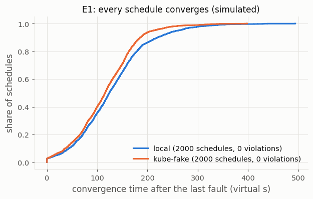
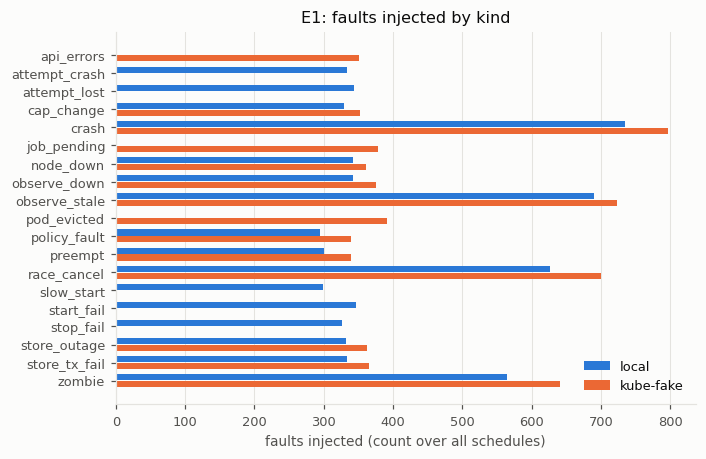
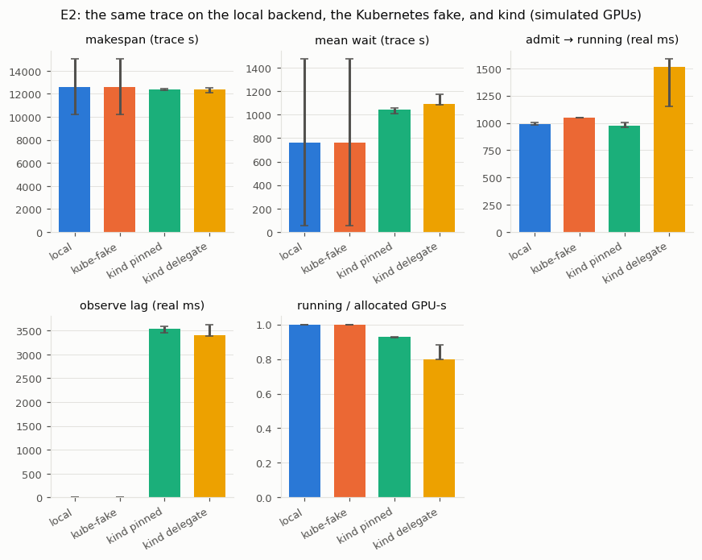
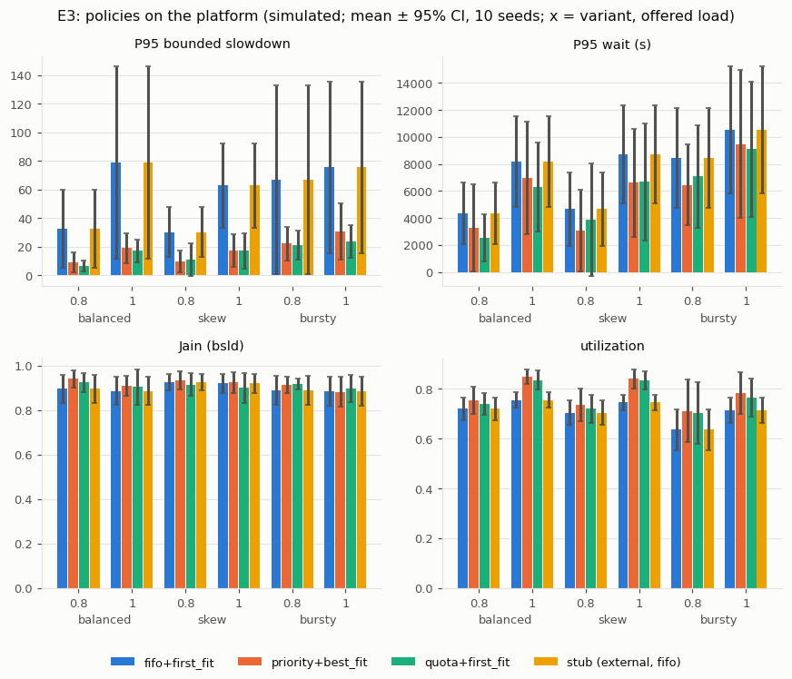
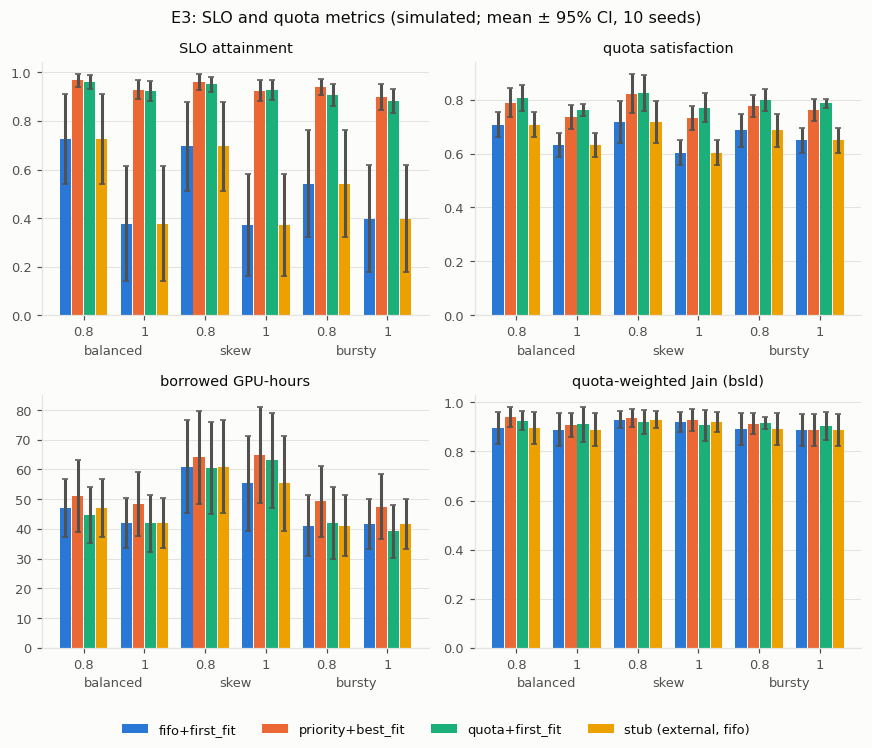
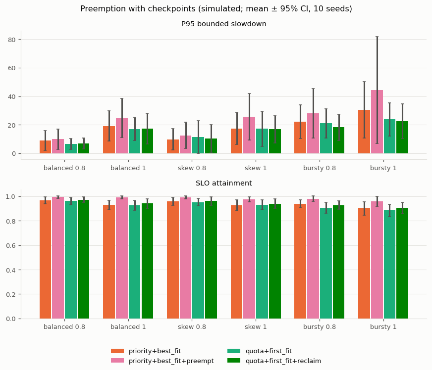
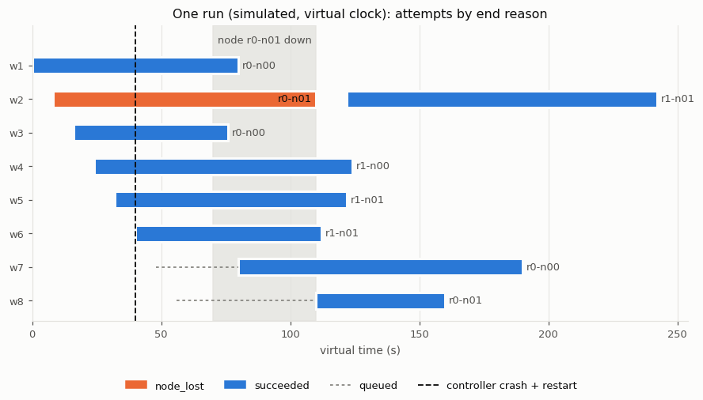

# Benchmarks

The benchmarks measure this control plane with workloads that sleep for their run time, on the virtual clock or as `sleep` pods on a local kind cluster with advertised GPUs.

## Reproduce

```bash
python -m ai_workload_platform bench --quick
python -m ai_workload_platform bench --full
python -m ai_workload_platform bench --cluster --kubeconfig outputs/kind/kubeconfig
python -m ai_workload_platform bench --cluster --sweep --kubeconfig outputs/kind/kubeconfig
python scripts/fake_measured.py
python scripts/kind_partial_gang.py --kubeconfig outputs/kind/kubeconfig
python scripts/kind_node_loss.py --kubeconfig outputs/kind/kubeconfig
python scripts/plot_results.py --suite full
python scripts/plot_timeline.py --suite full
```

`--quick` needs no Docker. `--cluster` and the `kind_*` scripts need the kind cluster of `deploy/README.md`, and `fake_measured.py` reads the kind results. The conformance check with `gpu-cluster-scheduler` (`scripts/conformance_07.py`) needs that project's simulator and policy server (`docs/contracts.md` §11).

Each suite writes small CSV/JSON files to `benchmarks/results/<suite>/` with a `manifest.json`. The manifest records the commit, the configuration hash, the seeds, the Python and library versions, the hardware class, the worker count, and a load note. For the cluster it also records the Docker, kind, and Kubernetes versions. Event logs go to the ignored `outputs/`, except the small run behind the timeline figure (`results/full/timeline_events.jsonl`). The demonstration scripts and the conformance script write one result file each and no manifest. Parallel runs use `spawn` worker processes. Results are sorted by (scenario, policy, seed) before they are written, so the files do not depend on the worker count.

## Protocol (fixed before the first evaluation run)

- **Reference system** (`configs/clusters/reference.json`, assumed): 4 nodes × 8 GPUs of class `a100` (speed 1.0) in racks `r0` and `r1` (2 nodes each), with 128 CPUs and 1024 GB per node. `cross_node_factor` is 1.1 and `cross_rack_factor` 1.25; both are 1.0 in E2 (`reference-e2.json`), because a real cluster has no topology penalty to match. `restart_overhead_s` is 120, used only by the preempting variants. Namespaces `team-a`, `team-b`, `team-c` have shares 0.4, 0.3, 0.3 → `quota_gpus` 12, 9, 9; `cap_gpus` is 32 and `max_queued` 200.
- **Traces** come from the generator (`bench/generator.py`, CLI `gen`). Its distributions are assumptions, shaped like those of `gpu-cluster-scheduler` and simplified:

| Parameter | Value |
|---|---|
| arrivals | Poisson at the offered load: mean rate = `load` × work capacity (32 reference GPU-s per s) / E[GPUs × workers × run time given the users drawn for the seed] (Monte Carlo, 20 000 draws on a fixed stream) |
| variants | `balanced` (namespace shares 0.4/0.3/0.3), `skew` (0.7/0.15/0.15), `bursty` (shares as balanced; a two-state Markov-modulated Poisson process: rate × 2.5 in the on state, × 0.25 off, mean sojourn 1800 s on / 3600 s off, starting in its stationary distribution) |
| users | 4 per namespace; each user's typical run time lognormal(ln 600 s, 0.8) drawn once per seed |
| run time | the user's typical value × lognormal(0, 0.8), truncated to [30 s, 7200 s] |
| sizes (GPUs × workers, probability) | 1×1 0.40, 2×1 0.25, 4×1 0.17, 8×1 0.10, 4×2 0.05, 8×2 0.03 (gangs rack-sensitive with probability 0.7) |
| priority classes | 1 (50 %, preemptible, no wait target), 4 (40 %, half preemptible, `max_wait_s` 3600), 8 (10 %, not preemptible, `max_wait_s` 600) |
| estimates | run time × lognormal(0, 0.5) |
| CPU, memory | 12 CPUs and 96 GB per GPU |

  Over 20 seeds of 300 workloads at a target of 0.8, the realized offered load is 0.82 (balanced), 0.83 (skew), and 0.87 (bursty). It is measured as total work over capacity × total arrival span. `tests/test_inputs.py` checks it to ±10 %, the namespace shares to ±0.03, and the size mix to ±0.03.
- **E1 Failure injection (the main result):** the harness of `docs/failure-injection.md` on schedule seeds 1–2000 per backend (local and the Kubernetes fake) in `--full`. The default tests use seeds 1–200 and `--quick` seeds 1–100. Each injected bug runs on seeds 1–200 per backend in `--full`.
- **E2 Backends:** trace `balanced`, load 0.8, 40 workloads, `fifo+first_fit`. (a) The local backend and (b) the Kubernetes backend on the fake client run trace seeds 1–10 on the virtual clock. (c) A kind cluster (4 workers with 8 advertised GPUs each) runs trace seed 1 in `pinned` and `delegate` modes, 3 repetitions each. Its `time_scale` is the longest run time / 60 s, so that the longest workload sleeps about one minute; `replay` divides the submit times and the backend the run times by it. The comparison says where the backends differ and why; it does not rank them.
- **E3 Policies on the platform:** `fifo+first_fit`, `priority+best_fit`, `quota+first_fit`, and the stub external policy, which implements `fifo+first_fit` over the protocol and must reproduce it. They run on `balanced`, `skew`, and `bursty` traces at offered loads 0.8 and 1.0, with 300 workloads and trace seeds 101–110. The runs use the local backend, the virtual clock, and the policies' defaults: there is no tuning, so there is no tuning set. E3 shows that the platform runs the policies and that their differences have the shape the policies imply; `gpu-cluster-scheduler` is the policy benchmark.
- **Statistics:** mean and 95 % Student-t interval across seeds, and paired differences against `fifo+first_fit` on the common seeds with their intervals. Win/tie/loss counts use a tie band of 5 % of the baseline value.
- **Wall-clock numbers** (the kind runs) are measured on an x86-64 desktop CPU with 24 cores and 32 logical processors (Windows 11). Each configuration is repeated 3 times, and the median, minimum, and maximum are reported. They stay out of every deterministic comparison. The virtual-clock results are deterministic: a seed gives a byte-identical event log.

## Results

All results come from commit `3b6e03b`: the evaluation suites, the kind demonstrations, `fake_measured.py`, and the conformance check. `scripts/kind_partial_gang.py` was added afterwards and changes no platform code. The in-cluster run under Extensions ran earlier, on the platform code of commit `5f78c2c`. [`results/full/table.md`](results/full/table.md) has every table with every policy (written by `scripts/plot_results.py`). The virtual evaluation (`results/full/manifest.json`) took 647 s of wall time with 4 worker processes. The kind runs (`results/cluster/manifest.json`, `manifest-sweep.json`) ran one service at a time.

The manifests say `dirty: true` because the flag comes from `git status` after a suite has written its own result files. Those files are tracked, so the flag is set whenever they differ from the committed ones (here, and in the quick results, also uncommitted figures and documentation). No source file differed from the recorded commit. A 12-worker and a 4-worker evaluation of the same commit wrote the same result files in every column except the wall-clock times; only the 4-worker files are committed.

### E1 Failure injection

Each seeded schedule submits 20–40 workloads and schedules 1–6 faults. The fault kinds are controller crashes at seven named points, a paused controller whose lease is taken over, store transaction failures and outages, observe outages and stale snapshots, node loss, attempt crashes and losses, start and stop failures, slow starts, evicted pods, pending Jobs, API errors, policy failures, forced preemptions, cancels racing with the controller's writes, and cap changes. Invariants I1–I6 and I8 are checked after every step, and the convergence invariant I7 when the run ends ([docs/failure-injection.md](../docs/failure-injection.md)).

| Backend | Schedules | Violating | Converged | Faults injected | Crash points hit | Convergence after the last fault P50 / P95 / max (virtual s) |
|---|---|---|---|---|---|---|
| local | 2000 | **0** | 2000 | 6 539 (16 kinds) | 735 (7 of 7) | 124.3 / 261.3 / 494.1 |
| Kubernetes fake | 2000 | **0** | 2000 | 6 480 (14 kinds) | 797 (7 of 7) | 115.7 / 211.8 / 398.3 |

Faults injected counts the faults that took effect. A crash, a controller pause, and a racing cancel count only when their point was reached (local: 735 of 986 scheduled crashes, 564 of 622 pauses). The others count when they were scheduled. 24 local and 27 fake schedules had no fault that took effect. Convergence is the virtual time until every workload is terminal and the backend holds nothing. It starts at the later of the end of the last fault and the end of the 300 s submission window. It therefore includes the remaining run time of the workloads; 815 local and 786 fake schedules count from the end of the submission window.

| Injected bug | Local: schedules caught of 200 (first seed) | Fake: caught of 200 (first seed) | First invariant violated |
|---|---|---|---|
| 1 `release_at_stop` | 176 (1) | 178 (1) | I5; I4 once per backend |
| 2 `no_epoch_check` | 3 (3) | 1 (126) | I5 (lease-epoch audit) |
| 3 `no_lost_grace` | 12 (32) | 4 (30) | I3 |
| 4 `no_version_check` | 29 (6) | 27 (6) | I5 |

Bug 2 is the hardest to reach. Compare-and-set alone rejects most writes of a paused controller, so only a schedule where the paused controller writes rows the new one never touched shows it (`docs/failure-injection.md`). The first full evaluation (commit `012db44`) had 3 of 4000 schedules that did not converge (I7). The cause and the fix are item 2 of "Bugs found in the platform during development" there, and these results are from the fixed commit.

Four bugs in the platform were found during development. The harness found two, one of them only in the full evaluation of an earlier commit: there, 3 of 4000 schedules stalled after a failed store transaction at a completion. One more turned up while checking that the harness catches an injected bug, and a rule test found the fourth. [docs/failure-injection.md](../docs/failure-injection.md) describes each with its seed and fix. A real-process test kills the live service three times while workloads run and checks the invariants from outside (`tests/test_kill.py`).





### E2 Backends

| Backend | Runs | Makespan (trace s) | Mean wait (trace s) | Admit → running (ms) | Observe lag mean / max (ms) | Placement match | Running / allocated |
|---|---|---|---|---|---|---|---|
| local | seeds 1–10 | 12 622 ± 2 397 | 763 ± 710 | 993 ± 8 | 0 / 0 | 1.00 | 0.999 |
| Kubernetes fake | seeds 1–10 | 12 624 ± 2 397 | 764 ± 710 | 1 050 | 0 / 0 | 1.00 | 0.999 |
| local (seed 1) | 1 | 10 526 | 523 | 971 | 0 / 0 | 1.00 | 0.999 |
| kind `pinned` (seed 1, `time_scale` 120) | 3 | 12 395 [12 278, 12 455] | 1 043 [1 009, 1 058] | 974 [963, 1 004] | 3 533 / 4 572 | 1.00 | 0.926 [0.923, 0.929] |
| kind `delegate` (seed 1, `time_scale` 120) | 3 | 12 375 [12 117, 12 500] | 1 090 [1 086, 1 173] | 1 510 [1 149, 1 586] | 3 396 / 4 394 | 0.22 [0.20, 0.37] | 0.799 [0.796, 0.881] |

Local and fake: mean ± 95 % Student-t half-width over seeds 1–10. On kind: median [min, max] of 3 runs; the observe-lag columns are the medians of the run means and of the run maxima. All 240 workloads on kind `SUCCEEDED` at their first attempt. Admit → running runs from the platform's `started` commit to its `running` commit; on kind it includes up to one observe interval (1 s). On the virtual clock the local backend starts at once, and its 993 ms is the driver's polling at the observe interval while a start is in flight. The fake reports the start at its modeled latency (50 ms + 1 s). Observe lag is how long after a pod ended the platform recorded it; on the virtual clock the driver observes exactly at the end.

The utilization column of `table.md` counts allocated GPU time over the submission window. On kind an allocation also holds the GPUs while a pod starts and until its end is recorded (seconds of real time, minutes of trace time). So utilization is higher there (0.86 against 0.73 on the local run of seed 1) without more work being done; read it together with running / allocated.

What differs and why: on kind an attempt takes about 1 s to start, and its end is recorded 3.4–3.6 s after it happens (run means; the kubelet and the Job controller report it). The maximum, 4.8 s, is within assumption A1's 10 s. `time_scale` turns that real time into minutes of trace time. Against the local run of the same trace (seed 1: makespan 10 526 s, mean wait 523 s), the mean wait doubles and the makespan grows by 18 %. The time-scale sweep (`bench --cluster --sweep`, `pinned`, 3 runs each) separates the compression from the backend. With `time_scale` 60, 120, and 240, the longest workload sleeps 120, 60, and 30 s of real time. The makespan is then 11 157, 12 395, and 14 108 trace s (local: 10 526). The mean wait is 517, 1 043, and 1 894 trace s (local: 523). The share of allocated GPU time without a running pod is 4.5 %, 7.4 %, and 11.4 % (medians). In `delegate` mode the kube-scheduler puts only 20–37 % of the workers on the nodes the policy chose (`placement_match`), and the starts take longer. These are properties of a compressed time scale, not a ranking of the backends.



### E3 Policies

P95 bounded slowdown, mean ± 95 % CI over trace seeds 101–110 (300 workloads each), and paired W/T/L against `fifo+first_fit`:

| Variant, load | fifo+first_fit | priority+best_fit | quota+first_fit | stub (external fifo) |
|---|---|---|---|---|
| balanced 0.8 | 32.4 ± 27.4 | 8.9 ± 6.9 (10/0/0) | 6.5 ± 3.8 (10/0/0) | 32.4 ± 27.4 (0/10/0) |
| balanced 1.0 | 78.7 ± 67.3 | 19.1 ± 10.6 (10/0/0) | 17.0 ± 8.2 (10/0/0) | 78.7 ± 67.3 (0/10/0) |
| skew 0.8 | 30.2 ± 17.6 | 9.8 ± 7.5 (10/0/0) | 11.2 ± 11.4 (10/0/0) | 30.2 ± 17.6 (0/10/0) |
| skew 1.0 | 62.8 ± 29.4 | 17.3 ± 11.3 (10/0/0) | 17.2 ± 12.3 (10/0/0) | 62.8 ± 29.4 (0/10/0) |
| bursty 0.8 | 67.0 ± 65.9 | 22.2 ± 11.9 (9/1/0) | 20.9 ± 10.2 (10/0/0) | 67.0 ± 65.9 (0/10/0) |
| bursty 1.0 | 75.5 ± 60.2 | 30.5 ± 19.8 (10/0/0) | 23.8 ± 11.6 (10/0/0) | 75.5 ± 60.2 (0/10/0) |

The differences have the shape the policies imply. `fifo+first_fit` blocks behind a large workload at the head of the queue, so its tail slowdown and its SLO attainment (0.37–0.73) are worst. The two skipping policies meet the wait targets of the high-priority classes far more often (0.88–0.97) and keep the cluster busier. SLO attainment is the share of succeeded workloads with a wait target that met it, within the measurement window. The window leaves out the first and the last 10 % of the terminal workloads by submission. P95 wait, Jain's index, utilization, and quota satisfaction are in `table.md`. The stub reproduces `fifo+first_fit` exactly on every seed. The intervals are wide because run times are heavy-tailed.





### Extensions

- **Preemption with checkpoints** (`results/full/e3_preemption.csv`; the same traces, paired with the base policy). `priority+best_fit+preempt` preempts 68–132 times per run on average. Averaged per setting, a run loses 7.9–13.5 GPU-hours of work and spends 6.6–11.4 GPU-hours in restart overhead. It raises SLO attainment in all six settings (for example 0.928 → 0.990 at `balanced` 1.0) and worsens the P95 bounded slowdown on 6–8 of 10 seeds. `quota+first_fit+reclaim` preempts 23–82 times per run on average, raises SLO attainment by 0.01–0.02, and splits wins and losses on the slowdown.
- **Conformance with `gpu-cluster-scheduler`** (`results/conformance/conformance.csv`). Its policy server runs through the protocol (`fifo+first_fit+none` and EASY), next to the built-in `fifo+first_fit`. All three runs give the same start times, end times, and placements as its simulator, for 3 × 200 workloads each: 0 differences (`docs/contracts.md` §11).
- **The platform inside the kind cluster.** A Deployment runs it with the in-cluster configuration and a least-privilege Role. A 12-workload trace replayed from inside the cluster all succeeded; this was one run on the platform code of commit `5f78c2c`. No result file is committed; [docs/kubernetes.md](../docs/kubernetes.md) describes the run.
- **Kubernetes depth** (`results/cluster/`). Besides the time-scale sweep above, the kube-scheduler could place only half of a 2 × 8-GPU gang in `delegate` mode, because pods of another tenant held three workers. It stayed `starting` until R2 ended it after `start_timeout_ms`, and its retry succeeded. A kind worker was stopped with `docker stop` while it ran a workload. The platform's inventory showed it not ready 46 s after the stop, and R4 requested the stop with reason `node_lost` 30 s later (`node_grace_ms`). The attempt ended when the node came back, and the retry ran 91.5 s after the start of the demonstration (one run). Setting the fake client's start latency from the kind measurement changes the makespan of a 2000-workload run by less than 0.01 %. At these run times the fake's assumed start latency therefore does not matter; what it does not model is the end-detection lag. The table is in [docs/kubernetes.md](../docs/kubernetes.md#kubernetes-depth).





The timeline is one run on the virtual clock. A controller crash comes right after a `started` commit, and R1 starts the write-ahead attempt again. A node is lost for 40 s. R4 requests the stop of the attempt on it after `node_grace_ms`, and the attempt ends when the node returns. The workload is retried on another node.

## Limitations

- Workloads sleep for their run time on the local backend and as busybox `sleep` in pods on kind. `image` and `command` are stored but not used, and the GPUs on kind are an advertised extended resource without a device plugin.
- A gang is atomic only at the platform level. In `delegate` mode the kube-scheduler can leave part of a gang pending, and R2 ends it after `start_timeout_ms`; there is no gang admission through Kueue, Volcano, or JobSet.
- The fault harness uses in-memory SQLite and the Kubernetes fake. PostgreSQL runs only the store contract suite and `docker compose`. The kind cluster runs the backend contract suite, E2 (c), the time-scale sweep, and the partial-gang and node-loss demonstrations.
- Interleavings happen only at named points in a single thread. Races inside a transaction, or between two simultaneously active controllers, are not explored: writers are serialized, and the lease makes one controller the writer.
- There is one controller per store. A standby that takes over by lease after the active one is killed is not built, and neither is the zombie test on real processes. Only the virtual harness covers the zombie case.
- `/metrics` exists, but there is no Prometheus compose profile, no alert rules, and no dashboard.
- There is no authentication, rate limiting, or retention. `up` binds to `127.0.0.1` by default, but the container image, the compose file, and the Deployment bind to `0.0.0.0`.
- Only the non-preempting `fifo+first_fit+none` and EASY of `gpu-cluster-scheduler` ran through the protocol. Its preempting and MILP policies have not run on the platform.
- The kind results are 3 repetitions per configuration, and one each for the partial-gang and node-loss demonstrations, on one desktop machine. They show where the backends differ, not how fast a production cluster is.
- The fake client reports the end of a pod at once, while kind records it 3.4–3.6 s later. This end-detection lag is the largest difference between the two, and the fake does not model it.
- An attempt on a node that never comes back stays `STOPPING` with its GPUs booked until the pod object disappears, for example when an operator deletes the node. Only a node that returned was demonstrated.
- The conformance CSV and the result files of `fake_measured.py`, `kind_node_loss.py`, and `kind_partial_gang.py` carry no manifest. Their commit is stated on this page only.
- The wake after a version conflict (bug 1 of `docs/failure-injection.md`) has no dedicated regression test. Its schedule came from an earlier version of the generator, so only the harness as a whole covers it.
- The PostgreSQL store expects a UTF8 database. With `SQL_ASCII` encoding psycopg returns text columns as bytes, and the PostgreSQL tests fail; nothing checks the encoding.
- Among its inputs, the `config_hash` of the committed manifests hashes the raw bytes of `configs/clusters/*.json`. Those manifests were written on a working tree in which `kind.json` and `reference-e2.json` ended with CRLF. A clone with LF line endings therefore computes another hash; the result columns do not differ.
- gRPC and Redis are not implemented.
